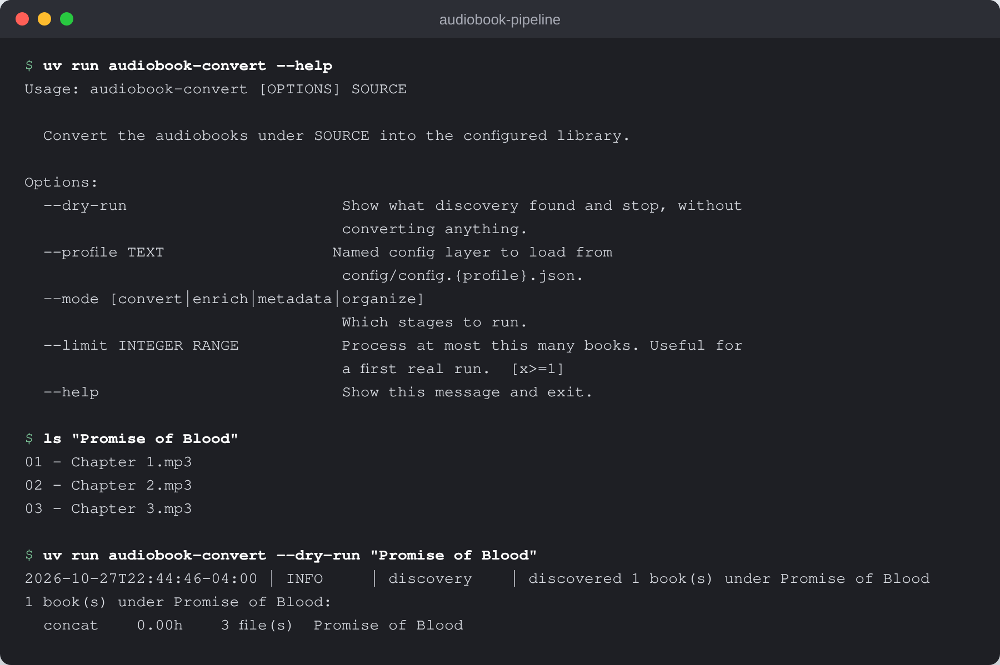

# audiobook-pipeline

Turn folders of loose audio files into chaptered, tagged M4B audiobooks with Audible metadata, filed the way Plex and Audiobookshelf expect.

[](LICENSE)
[](https://www.python.org/)
[](.github/workflows/ci.yml)



## What it is

A Python command-line pipeline that converts directories of audio into chaptered M4B audiobooks, enriches their metadata from the Audible catalogue, and places completed books in a library.

A folder of loose MP3s goes in:

```
Promise of Blood/
  01 - Chapter One.mp3
  02 - Chapter Two.mp3
  ...
```

One tagged, chaptered M4B comes out, filed where Plex and Audiobookshelf
expect it:

```
Brian McClellan/Powder Mage/Book 1 - Promise of Blood/
  Book 1 - Promise of Blood.m4b
```

## Why it exists

Audiobooks often arrive as dozens of loosely named MP3s with missing or inconsistent tags. Media servers want one file per book with chapters, cover art, author, narrator and series, in a predictable folder layout. Doing that by hand for a large collection is slow and easy to get wrong, especially matching each book to the right edition. This pipeline does the conversion, the matching and the filing in one resumable run.

## How it works



`audiobook-convert` (or `audiobook-watch` for an incoming folder) starts with `discovery.py`, which finds the books under the source path and decides whether each needs its files concatenated. `pipeline.py` then runs the stages listed in `models/stage.py`: validate, concat, convert (ffmpeg to a chaptered M4B, carrying chapter marks over from the source where they exist), asin, metadata, organize, archive and cleanup. The asin stage searches the Audible catalogue by title and accepts a match only when it agrees with the audio's real duration, so a wrong edition is not adopted silently; an OpenAI-compatible resolver can be enabled for hard cases. Every stage result is recorded in a SQLite database, so an interrupted batch resumes where it stopped. `audiobook-audit` checks an existing library read-only.

## Features

- Concatenates multi-file books and converts them to chaptered M4B with ffmpeg.
- Title, author, narrator, series, cover art and ASIN from the Audible catalogue, with a duration check against the real audio.
- Library layout of `Author/Series/Book N - Title/`, with an `.author-override` marker for franchise folders.
- Four modes: `convert`, `enrich`, `metadata` and `organize`, so identity work can be redone without re-encoding.
- Resumable runs backed by SQLite, with transient failures retried and permanent ones recorded.
- `--dry-run` and `--limit` for safe first runs; a watch mode for an incoming folder.
- Read-only library audit and source-to-library diff.
- Optional AI-assisted matching through any OpenAI-compatible endpoint (off by default).

## Quick start

### Requirements

- **ffmpeg** — does the actual audio work. Install it first; nothing runs
  without it.
- **uv** — manages Python 3.13 and the locked dependencies. Do not use a
  system Python.

```bash
# macOS
brew install ffmpeg uv

# Debian/Ubuntu
sudo apt install ffmpeg && curl -LsSf https://astral.sh/uv/install.sh | sh
```

### First run

From the repository root:

```bash
./scripts/run setup
uv run audiobook-convert --dry-run /path/to/one-book
```

The dry run discovers books and prints the plan without converting anything,
writing a database, or acquiring the batch lease. **Start with one book** and
read what it found — discovery is where a wrong folder layout shows up, and
it costs nothing to check. When it looks correct, remove `--dry-run`:

```bash
uv run audiobook-convert /path/to/one-book
```

Converted books land under `data/library/` unless you point
`paths.library_dir` somewhere else.

**The source directory is moved, not copied.** After a successful conversion
the original folder is relocated to `data/archive/` so a re-run does not
reprocess it. Nothing is deleted — but if you expect your source tree to stay
where it was, point `paths.archive_dir` somewhere you are happy with. Setting
`AUDIOBOOK_LEVEL=simple` also skips archiving, but it skips organizing too, so
the M4B stays in the work directory rather than being filed into the library.

See [docs/install.md](docs/install.md) for configuration, profile, audit, and
watch details. See [docs/ai.md](docs/ai.md) before enabling AI resolution.

## Commands

```bash
# Convert, enrich, metadata-only, or organize-only work.
uv run audiobook-convert /path/to/books
uv run audiobook-convert --mode enrich /path/to/books
uv run audiobook-convert --mode metadata /path/to/books
uv run audiobook-convert --mode organize /path/to/books

# Keep the first real batch bounded.
uv run audiobook-convert --limit 1 /path/to/books

# Read-only library audit and source-to-library comparison.
uv run audiobook-audit /path/to/library
uv run audiobook-audit /path/to/source --diff /path/to/library

# Continuously process stable candidates in the configured incoming directory.
uv run audiobook-watch
```

Each command accepts `--profile NAME`, which loads `config/config.NAME.json`
over the committed shared configuration. `sandbox` is the only profile committed
to this repository. Create your own from one of the worked examples in
[examples/config/](examples/config/) — there is one each for Plex,
Audiobookshelf, a watch-folder daemon, and AI-assisted matching:

```bash
cp examples/config/plex.json config/config.plex.json
# edit the paths, then
uv run audiobook-convert --profile plex --dry-run /path/to/one-book
```

A `--profile` naming a file that does not exist is **not** an error — the
command runs with the committed defaults under `data/`. Check the paths in a
`--dry-run` before a real run.

Library audits exit `1` when they find critical problems. Library diffs exit
`1` while source books are missing from the target. Warnings and informational
findings remain report-only.

## Configuration

The application reads committed JSON configuration in `config/config.json`, an
optional selected profile, and an optional gitignored `secrets/config.json`.
Environment variables override all JSON layers. Their names start with
`AUDIOBOOK_`, with `__` separating nested fields:

```bash
AUDIOBOOK_PATHS__LIBRARY_DIR=/media/audiobooks \
  uv run audiobook-convert --dry-run /path/to/one-book
```

Defaults keep pipeline data under `data/`; choose real paths through a profile
or environment variables before a non-dry run. Do not put credentials in a
committed configuration file.

## Modes and levels

`--mode` controls the pipeline operation: `convert`, `enrich`, `metadata`, or
`organize`. `AUDIOBOOK_LEVEL` controls policy independently:

| Level | Behavior |
| --- | --- |
| `simple` | Omits organization and archive stages. |
| `normal` | Default level; runs the normal stage sequence without AI resolution. |
| `ai` | Enables OpenAI-compatible candidate resolution when configured. |
| `full` | Uses the same configured AI resolver as `ai`. |

AI levels require `AUDIOBOOK_AI__BASE_URL`; [docs/ai.md](docs/ai.md) shows the
complete opt-in configuration.

## Author override marker

Place an empty `.author-override` file in a franchise directory to force every
organized book below it into that directory's author folder. For example,
`Dragonlance/.author-override` files the subtree under author `Dragonlance`,
even when Audible credits different writers. The search is bounded by the
source passed to `audiobook-convert`, and it changes placement only; embedded
author tags retain the credited author.

## When something goes wrong

Every run writes a DEBUG-level log to `data/logs/pipeline.log` regardless of
what the console shows, so the detail is there after the fact. Start with:

```bash
uv run audiobook-audit --status failed --failures
```

That prints the recorded error for every book that failed.

| Symptom | Cause and fix |
| --- | --- |
| `discovered 0 book(s)` | The path holds no readable audio, or the audio is one level deeper than you pointed. Point at the folder that directly contains the files, and check the WARNING lines naming each skipped file. |
| `ffprobe failed` | ffmpeg is missing, or the file is corrupt or zero-length. Run `ffmpeg -version`, then try `ffprobe` on the named file directly. |
| Book filed under `Unknown Author` | The catalogue could not identify it and the folder layout named no author. Rename to `Author/Book Title/` or add a `.author-override` marker. |
| Wrong book matched from Audible | The duration guard rejects wrong editions, but a same-length edition can slip through. Use `--mode metadata` to redo identity work without re-encoding. |
| `requires ai.base_url, which is empty` | `AUDIOBOOK_LEVEL` is `ai` or `full` with no resolver configured. Set `AUDIOBOOK_AI__BASE_URL`, or use `normal`, which never calls an LLM. |
| Second run reprocesses the same book | The first run did not reach the archive stage, so the source is still in place. Check the failure with the audit command above. |

The pipeline is resumable. Stages already completed are recorded in
`data/work/pipeline.db` and skipped on a re-run, so fixing a configuration
problem and running the same command again picks up where it stopped rather
than re-encoding from scratch.

## Project status

Active. The Python implementation is covered by the test suite (`uv run pytest`), and CI runs the repository's standards gate and tests on every push.

## Credits

[CREDITS.md](CREDITS.md) records the direct dependencies and external catalogue
services evidenced by the current source, including [ffmpeg](https://ffmpeg.org/) and the Audible catalogue.

## Licence

[MIT](LICENSE). Copyright (c) 2025 Rico Rojas.

## Author

Rico Rojas, https://rico-rojas.com
